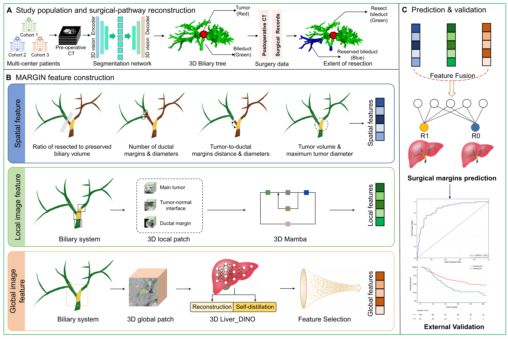
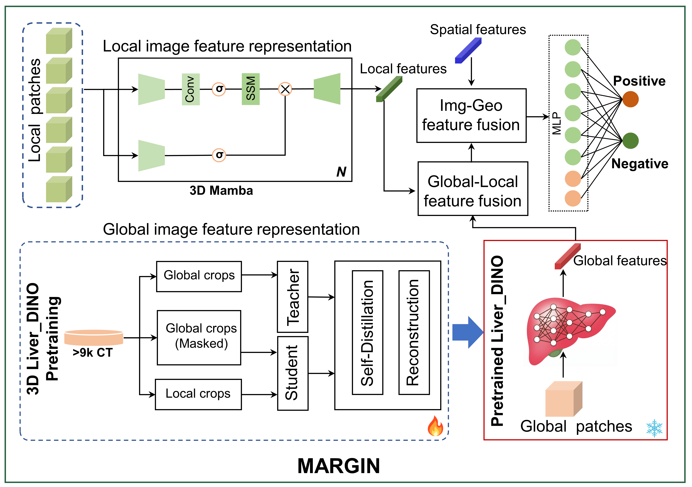
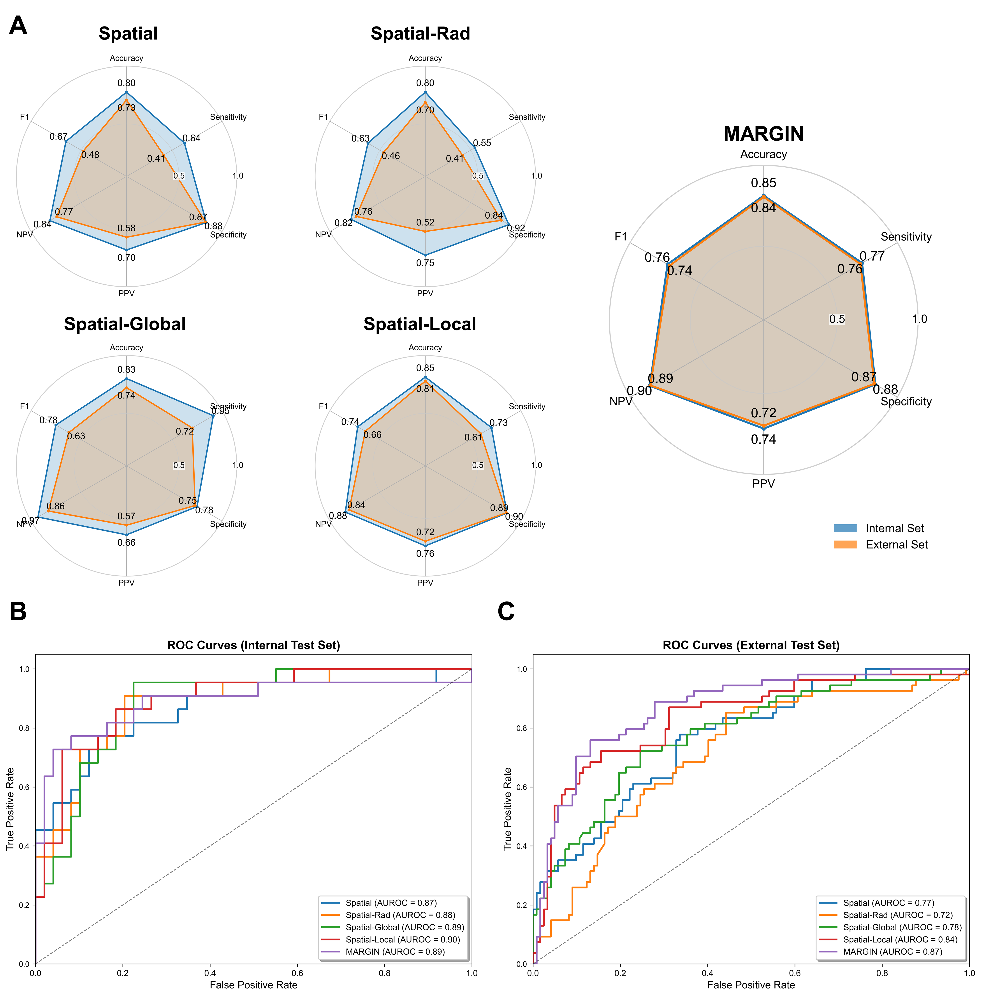

<div align="center">

# MARGIN

### Biliary & Tumor Segmentation · Multimodal Margin Prediction

**Preoperative CT-Based Prediction of Margin Status along Resection Planes in Perihilar Cholangiocarcinoma**

[Project website](https://sunkai-tsinghua.github.io/MARGIN/) · [Segmentation models](#part-1-nnu-net-biliary-and-tumor-segmentation-models) · [MARGIN training code](#part-2-margin-training-code) · [中文说明](README.zh-CN.md)

**Release status: coming soon**

</div>

## Overview

MARGIN is a research project on CT-based prediction of microscopic margin status in **perihilar cholangiocarcinoma (pCCA)**. The workflow combines anatomical reconstruction with spatial, local, and global image representations to support research on individualized surgical planning.

**Our open-source release is organized into two distinct parts:**

1. **nnU-Net-based biliary and tumor segmentation models** — trained models for segmenting the biliary tree and primary tumor from preoperative contrast-enhanced CT.
2. **MARGIN training code** — code for training the downstream multimodal framework for patient-level margin-status prediction.

These components address different tasks. The segmentation models generate anatomical masks; MARGIN integrates anatomical spatial features and multiscale CT features to predict margin status. **MARGIN is not the segmentation network.**

| Component | Task | Planned release | Status |
| --- | --- | --- | --- |
| **Part 1: nnU-Net segmentation models** | Biliary tree and primary tumor segmentation from CT | Trained model weights and inference instructions | **Coming soon** |
| **Part 2: MARGIN training code** | Multimodal learning for patient-level R0 / R1 prediction | Training code and configuration instructions | **Coming soon** |

The current repository contains the project website and documentation. Model weights and executable MARGIN training code have **not yet been released**. Download links and runnable commands will be added with their corresponding releases.

## Part 1: nnU-Net biliary and tumor segmentation models

This release focuses on the **customized 3D nnU-Net models used to segment the biliary tree and primary tumor** from preoperative contrast-enhanced CT in patients with pCCA.

- **Model family:** customized 3D nnU-Net.
- **Input:** preoperative contrast-enhanced CT.
- **Segmentation targets:** biliary tree and primary tumor.
- **Training cohort reported in the manuscript:** 197 manually annotated pCCA CT scans.
- **Planned package:** trained model weights and instructions for preprocessing, inference, and interpreting the output labels.
- **Availability:** coming soon.

In the reported study, two senior radiologists reviewed and refined all automated segmentation results before the finalized masks were used for 3D biliary reconstruction. CT images and masks were subsequently resampled to 1 × 1 × 1 mm for downstream feature extraction; this is **not a specification of the segmentation model's training or inference spacing**.

The exact nnU-Net version, model configuration, label mapping, environment requirements, and inference commands will be documented with the model release. No segmentation Dice or IoU score is claimed on this page.

See the [segmentation model card](docs/segmentation-model.md). For the upstream framework, see [MIC-DKFZ/nnUNet](https://github.com/MIC-DKFZ/nnUNet).

## Part 2: MARGIN training code

This release contains the **training code for MARGIN**, the multimodal adaptive resection guided integration network used for patient-level margin-status prediction.

The framework integrates three complementary feature streams:

| Stream | Representation |
| --- | --- |
| **Spatial features** | Eight features derived from the patient-specific 3D biliary model and reconstructed resection planes, describing tumor burden, margin geometry, and tumor–biliary relationships |
| **Local image features** | Six local CT patches from the main tumor, tumor–biliary interface, and reconstructed margin regions, encoded by a shared-weight 3D Mamba backbone |
| **Global image features** | Broader liver and tumor-context representations extracted using Liver-DINO |

These streams are integrated by a residual multimodal fusion framework. Set-level scores are averaged within each patient for patient-level evaluation. Histopathological assessment of ductal margins serves as the reference standard.

**Planned package:** MARGIN training code and configuration instructions. Dependencies, feature preparation, training entry points, and evaluation instructions will be provided when the code is released. This release should not be interpreted as an announcement that clinical data, Liver-DINO weights, or MARGIN checkpoints are currently available.

See the [MARGIN training overview](docs/margin-training.md).

## Study workflow



**CT segmentation → reviewed anatomical masks → 3D biliary reconstruction → spatial, local and global feature extraction → MARGIN training and patient-level prediction.**

In this retrospective study, resection planes were reconstructed using surgical records and postoperative CT. The framework has not yet been validated for comparing multiple alternative surgical plans for an individual patient.

## MARGIN architecture



## Research findings

The manuscript reports a retrospective multicenter study of **410 patients** from **three centers**, including an independent external test set of **176 patients**.

| MARGIN metric | Independent external test set |
| --- | ---: |
| AUROC | 0.87 |
| Accuracy | 0.84 |
| Sensitivity | 0.76 |
| Specificity | 0.87 |
| Positive predictive value | 0.72 |
| Negative predictive value | 0.89 |

**These are patient-level margin-status prediction results for MARGIN, not segmentation performance metrics for nnU-Net.**

In a paired reader study involving five hepatobiliary surgeons, mean accuracy increased from 0.71 to 0.84 and mean sensitivity from 0.20 to 0.62 with MARGIN assistance. Mean specificity remained 0.94.



## Research scope and availability

This is a research project. The reported study was retrospective, restricted to resected patients, and conducted within one country. Prospective validation remains necessary before clinical deployment. Predictions are intended to support further research into surgical decision support and do not replace specialist assessment.

Patient-level clinical data are not included in this repository. Release licenses and terms for each component will be specified with the corresponding release; the availability of this project page does not itself grant a license to unreleased code or weights.

## Website

This repository also contains a dependency-free, responsive project website in `index.html`, `styles.css`, and `script.js`.

For local preview, run from this directory:

```bash
python3 -m http.server 8000 --bind 127.0.0.1
```

Then open `http://127.0.0.1:8000` in your browser. See [GitHub Pages deployment instructions](DEPLOY.md) to publish the website.
