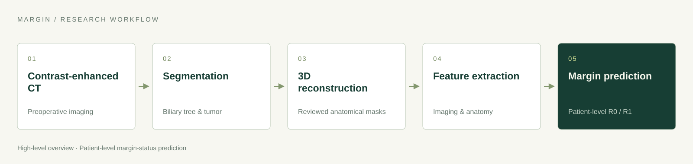

# Part 2 — MARGIN training code

**Release status: coming soon** · [Project overview](../README.md) · [Part 1: segmentation models](segmentation-model.md)

## Purpose

MARGIN is a research framework for CT-based, patient-level margin-status prediction in perihilar cholangiocarcinoma. It uses imaging and anatomical information to study R0 / R1 margin status. Training code is planned for a future release.

## Workflow overview

**Contrast-enhanced CT → segmentation → 3D reconstruction → feature extraction → margin prediction.**

The segmentation models in Part 1 provide anatomical masks. In the reported study, radiologists reviewed and refined the masks before reconstruction. Resection planes were retrospectively reconstructed from surgical records and postoperative CT. The framework has not been validated for comparing alternative surgical plans for an individual patient.

## Planned release materials

The future release will provide MARGIN training code, configuration instructions, dependencies, and usage documentation. MARGIN training code, prediction checkpoints, and clinical data are not included in the current release.

For the currently available nnU-Net weights and inference scripts, see the [segmentation model card](segmentation-model.md).

## Research use

MARGIN is a research framework. Prospective validation is required before clinical deployment. Predictions do not replace specialist assessment.
