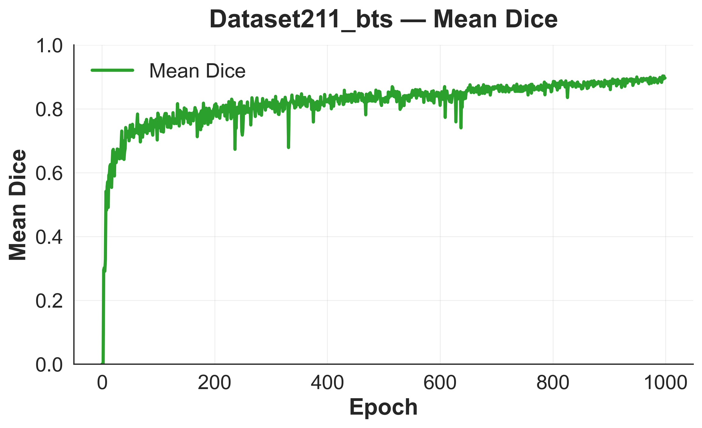
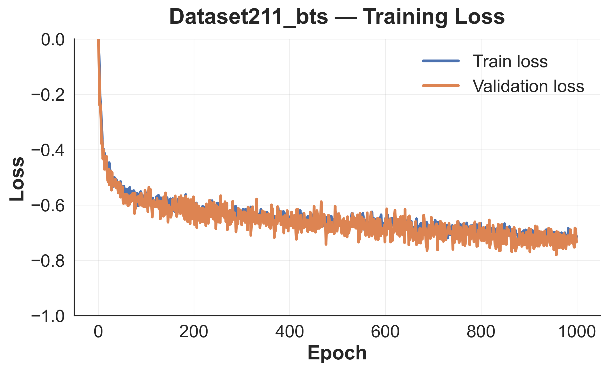
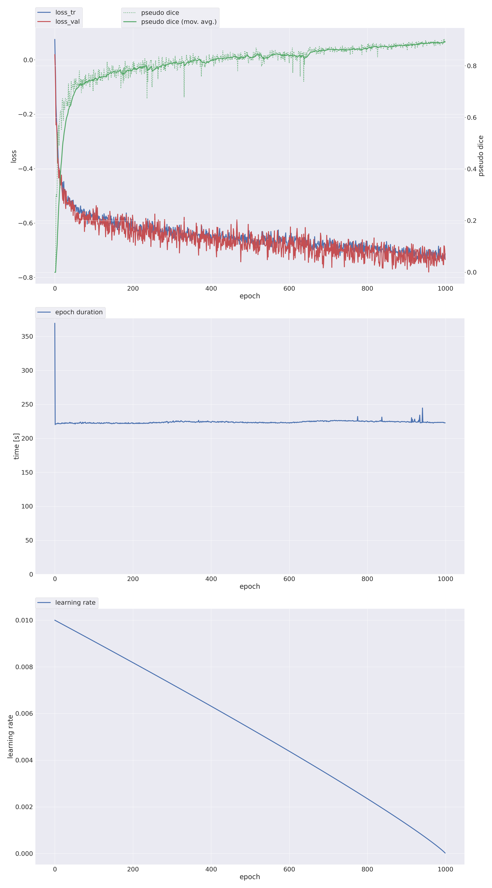

# Biliary and tumor segmentation — model details

[Download model package](https://github.com/SunKai-Tsinghua/MARGIN/releases/download/segmentation-v1.0.0/MARGIN-segmentation-v1.0.0.zip) · [Python inference](../segmentation/inference.py) · [Inference notebook](../segmentation/inference.ipynb) · [Project overview](../README.md)

## Model and training configuration

This release provides one region-based 3D nnU-Net checkpoint for biliary tree and primary tumor segmentation from preoperative contrast-enhanced CT in perihilar cholangiocarcinoma. The settings below are read from the supplied model package, checkpoint metadata, and training configuration.

| Field | Value |
| --- | --- |
| Dataset | `Dataset211_bts`; 197 training cases |
| Input | One CT channel (`0000`), NIfTI `.nii.gz` |
| Trainer | `nnUNetTrainer` |
| Plans / configuration | `nnUNetResEncUNetLPlans` / `3d_fullres` |
| Network | `ResidualEncoderUNet`; six stages, features `[32, 64, 128, 256, 320, 320]` |
| Checkpoint / fold | `checkpoint_best.pth` / `fold_all` |
| Training patch size | `[160, 224, 192]` in nnU-Net's internal spatial order |
| Planned spacing | `[1.0, 1.0, 1.0]` mm |
| Reader / normalization | `NibabelIOWithReorient` / `CTNormalization` |
| Training batch size / schedule | 2 / 1,000 epochs |
| Loss | Dice + binary cross-entropy with deep supervision |
| Recorded training PyTorch | `2.2.2+cu121` |
| Accompanying nnU-Net source | `2.5.1` |

`fold_all` is a model trained on all training cases, not a five-fold ensemble. The original `checkpoint_best.pth` is provided unchanged; the final checkpoint and intermediate checkpoint are not used. This is an inference package, not a complete training-data release.

## Download and directory layout

Download the ZIP above and extract it. Its SHA-256 is `99d22b4a524e3b2829aceb05f7cf9da5286cf113a87ff922036bf1d897776d19`. Set `MODEL_DIR` to the directory immediately containing `dataset.json` and `plans.json`:

```text
nnUNetTrainer__nnUNetResEncUNetLPlans__3d_fullres/
├── dataset.json
├── plans.json
└── fold_all/
    └── checkpoint_best.pth
```

The release contains these three files only. Training curves are separately available below. Clinical images, prediction volumes, the `validation` directory, training logs, and other checkpoints are not distributed as separate files. The original best checkpoint retains its original training-state contents. `dataset_fingerprint.json` is not needed for inference.

## Environment setup

Use a dedicated Python 3.10–3.12 environment. From the cloned repository root:

```bash
python -m venv .venv
source .venv/bin/activate
python -m pip install -r segmentation/requirements.txt
```

The requirements pin nnU-Net 2.5.1 and PyTorch 2.5.1 as a compatibility baseline. For an NVIDIA GPU, install the CUDA-compatible PyTorch 2.5.1 build appropriate for your system using the [official PyTorch installation instructions](https://pytorch.org/get-started/previous-versions/#v251), then install the requirements. CPU inference is supported by the script but is slower. GPU memory requirements have not been benchmarked for this release.

For the notebook, also install Jupyter and select this environment's kernel:

```bash
python -m pip install notebook ipykernel
python -m ipykernel install --user --name margin-segmentation --display-name "MARGIN segmentation"
jupyter notebook segmentation/inference.ipynb
```

The original training environment and this suggested inference environment are distinct. **No model inference or environment compatibility test has been executed for this release.** The scripts follow the standard nnU-Net v2 inference API. Load only trusted `.pth` files, as PyTorch checkpoints may contain pickled objects.

## Prepare CT inputs

Place each single-channel, 3D contrast-enhanced CT in a separate file, with its original geometry and Hounsfield-unit intensities:

```text
imagesTs/
├── case001_0000.nii.gz
└── case002_0000.nii.gz
```

The `_0000` suffix identifies the CT channel. Convert DICOM to NIfTI before using this entry point. Do not supply masks, screenshots, pre-normalized arrays, or additional modalities in this folder. nnU-Net applies reorientation, cropping, CT normalization and resampling from the bundled plans, and restores predictions to the original image geometry. Do not manually resize inputs to the training patch size.

The actual plans specify 1 mm isotropic spacing; this value is verified from `plans.json`, independently of the downstream feature-extraction spacing described in the manuscript.

## Run the Python script

```bash
python segmentation/inference.py \
  --model-dir /absolute/path/to/nnUNetTrainer__nnUNetResEncUNetLPlans__3d_fullres \
  --input-dir /absolute/path/to/imagesTs \
  --output-dir /absolute/path/to/predictions \
  --device cuda
```

Use `--device cpu` when CUDA is unavailable. Optional arguments:

| Argument | Effect |
| --- | --- |
| `--disable-tta` | Disable mirroring test-time augmentation; predictions may differ |
| `--save-probabilities` | Save nnU-Net's region probabilities and accompanying metadata |
| `--continue-prediction` | Skip existing outputs; otherwise predictions are overwritten |
| `--num-processes 1` | Preprocessing and export workers; default is 1 |

The script uses a sliding-window step of 0.5, Gaussian weighting, and mirroring by default. It explicitly loads `use_folds=('all',)` and `checkpoint_name='checkpoint_best.pth'`; automatic fold discovery would omit `fold_all`. It does not add connected-component filtering or other undocumented postprocessing.

## Equivalent standard nnU-Net command

The official model-folder entry point can be used directly without setting `nnUNet_results`:

```bash
nnUNet_compile=false nnUNetv2_predict_from_modelfolder \
  -m /absolute/path/to/nnUNetTrainer__nnUNetResEncUNetLPlans__3d_fullres \
  -i /absolute/path/to/imagesTs \
  -o /absolute/path/to/predictions \
  -f all \
  -chk checkpoint_best.pth \
  -device cuda \
  -npp 1 -nps 1
```

The [notebook](../segmentation/inference.ipynb) provides editable paths, calls the Python script in a subprocess, and includes optional output geometry and label checks. Notebook outputs are intentionally empty.

## Output labels and regions

Each `case001_0000.nii.gz` input produces `case001.nii.gz` in the output directory.

| Exported label | Meaning |
| --- | --- |
| 0 | Background |
| 1 | Biliary label, excluding voxels assigned to tumor |
| 2 | Tumor |

This is a **region-based model**, with the exact dataset definitions:

```json
"labels": {"background": 0, "danguan": [1, 2], "tumor": 2},
"regions_class_order": [1, 2]
```

The first prediction region (`danguan`) is the union of labels 1 and 2; the second is tumor (label 2). Region-to-label conversion assigns the tumor label last. Use `mask == 1` for the non-tumor biliary label, `mask == 2` for tumor, and `mask > 0` to recover the combined `danguan` region used during training. Saved probabilities contain two region channels, not background/bile-duct/tumor softmax channels.

## Training curves

These supplied PNGs document training progress. The curves, including pseudo-Dice and validation-loss traces, are training-time monitoring signals; they do not establish independent test-set Dice or IoU. No patient images or validation prediction files are included.

### Dice trace



### Loss trace



### Full training progress



## Research use and interpretation

In the reported study, two senior radiologists reviewed and refined automated masks before 3D reconstruction and downstream analysis. Review segmentation quality before using predictions. MARGIN margin-status prediction results do not measure segmentation quality. No independent segmentation-performance claim is made here. A project-specific code/weight license has not yet been specified; upstream dependencies retain their own licenses.

## Upstream references

- [nnU-Net repository](https://github.com/MIC-DKFZ/nnUNet)
- [Standard nnU-Net inference implementation](https://github.com/MIC-DKFZ/nnUNet/blob/v2.5.1/nnunetv2/inference/predict_from_raw_data.py)
- [Dataset naming and channel conventions](https://github.com/MIC-DKFZ/nnUNet/blob/v2.5.1/documentation/dataset_format.md)
